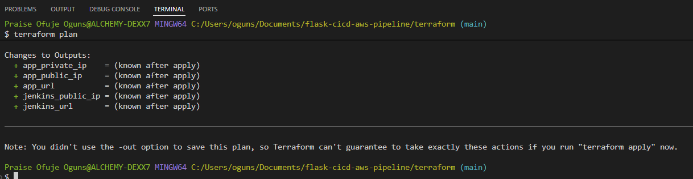
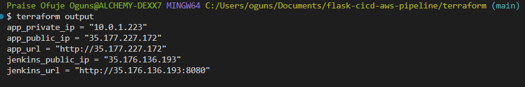
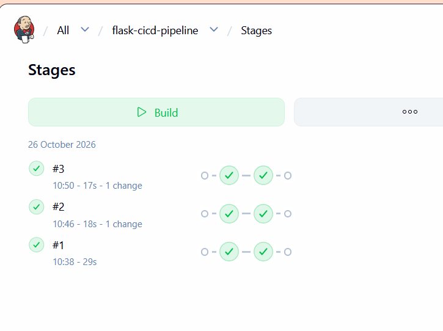
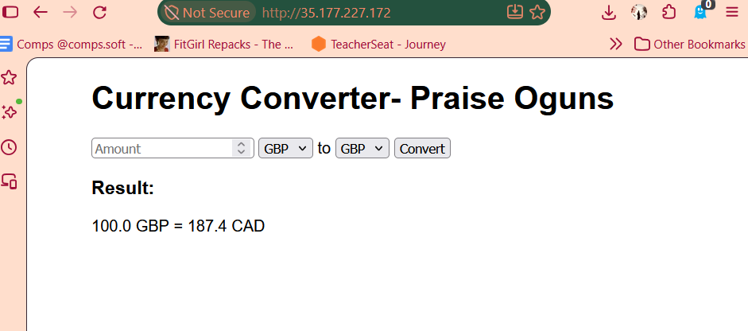
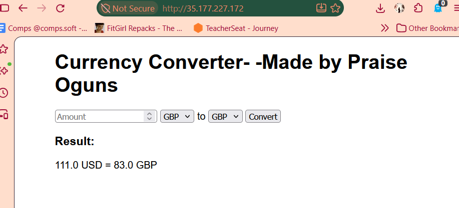
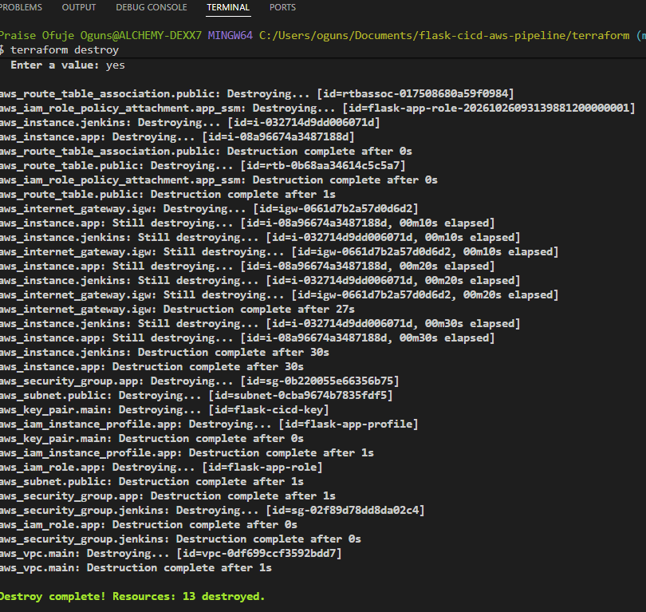

# Flask Currency Converter on AWS with Jenkins and Terraform

I built this to practise getting code from my laptop to a server without anyone logging in by hand. The app is a small currency converter. The setup around it is the interesting part.

I originally built this pipeline manually in an AWS Learner Lab, then refactored the whole setup into Terraform on my own AWS account so I wouldn't lose the architecture when the lab expired. Now, when I push a change to GitHub, Jenkins picks it up and redeploys the app automatically. Terraform builds all 13 AWS resources from scratch, so the whole environment can be created or deleted with one command.

## What the app does

- Converts between GBP, USD and CAD using live exchange rates.
- Rejects negative amounts.
- Shows an error if the exchange rate service can't be reached.

## How it works

```text
I push to GitHub
      |
Jenkins (its own EC2 instance) checks the repo every 2 minutes
      |
Jenkins connects to the app server over SSH (via internal VPC private IP)
      |
The app server pulls the code and rebuilds the containers
      |
Browser --> Nginx (port 80) --> Flask container (port 5000)
```

The app runs in Docker Compose with two containers. Nginx is the only one that is open to the internet, and Flask is only reachable through Nginx.

## What Terraform builds

- A custom VPC with one public subnet, an internet gateway and a route table.
- Two Ubuntu EC2 instances: one for Jenkins, one for the app.
- Security groups: SSH and the Jenkins web page (8080) are only open to my IP, the app server only accepts SSH from the Jenkins security group, and port 80 is public facing,  open to everyone.
- An IAM role and instance profile on the app server that only allows AWS Systems Manager (SSM) access.
- An AWS key pair, encrypted disks, and IMDSv2 required on both instances.

Jenkins runs as a Docker container on its own server. Docker and Git are installed on both servers automatically on boot via `user_data` startup scripts.

## Project screenshots

### 1. Terraform infrastructure provisioning and outputs





### 2. Automated CI/CD pipeline (Jenkins stage view)



### 3. Live app: before and after a code push

**Before changes**



**After code push (live update)**



### 4. Tearing down the environment (`terraform destroy`)



## Files

```text
app.py                 The Flask app
external.txt           Python dependencies
Dockerfile             Builds the Flask image
docker-compose.yml     Runs Flask and Nginx
nginx/nginx.conf       Nginx reverse proxy config
Jenkinsfile            The deploy pipeline
terraform/             Infrastructure as Code (VPC, EC2, IAM, Security Groups)
screenshots/           Project build and deployment screenshots
```

## How to run it on your own machine

You will need to have Docker and Docker Compose.

```bash
git clone https://github.com/praise-oguns/flask-cicd-aws-pipeline.git
cd flask-cicd-aws-pipeline
docker compose up --build
```

Open http://localhost in your browser.

## Build the whole thing on AWS

You need Terraform, the AWS CLI set up with your credentials, and an SSH key.

### 1. Create `terraform/terraform.tfvars` with your details

```hcl
my_ip = "YOUR.IP.ADDRESS/32"
public_key_path = "C:/Users/you/.ssh/id_ed25519.pub"
```

### 2. Build the servers

```bash
cd terraform
terraform init
terraform plan
terraform apply
```

### 3. Set up Jenkins

Wait about 3 minutes for the startup scripts to finish, then open the `jenkins_url` that Terraform prints.

Unlock Jenkins with the password from:

```bash
sudo docker exec jenkins cat /var/jenkins_home/secrets/initialAdminPassword
```

Install the suggested plugins and the SSH Agent plugin.

Add an SSH credential with these details:

- **ID:** `app-server-key`
- **Username:** `ubuntu`
- **Private key:** the private key that matches your public key

### 4. Configure the pipeline

Put the `app_private_ip` from Terraform into the `Jenkinsfile` and push it to GitHub.

Create a Pipeline job from this repo with these settings:

- **Branch:** `*/main`
- **Script path:** `Jenkinsfile`
- **Build trigger:** Poll SCM
- **Schedule:** `H/2 * * * *`

### 5. Test the deployment

Push a change to `app.py` and watch Jenkins deploy it within approximately 2 minutes.

The app is live at the `app_url` that Terraform prints.

### 6. Tear down the environment

When you're done, run:

```bash
terraform destroy
```

This removes the resources managed by this Terraform configuration. Review the plan before confirming so you know what will be deleted.

Remember to destroy the environment when you're finished so you don't pay for idle servers.

## What I learned

- The app server only accepts SSH from the Jenkins security group, and that rule only matches private addresses. Jenkins has to connect to the private IP (`10.0.1.x`), not the public one.
- Moving the setup from an AWS Learner Lab into Terraform means I own the code for the whole network and can delete everything and rebuild it in a few minutes without paying for idle EC2 time.
- Polling every 2 minutes (`H/2 * * * *`) lets me keep the Jenkins page locked to my IP. A GitHub webhook would need inbound access for webhook deliveries from GitHub, which would require changing the current access rules.

## Changes to make in future

- Add unit tests and run them in the pipeline before it deploys.
- Add a domain name and HTTPS to Nginx.

## Author

Praise Oguns

GitHub: [praise-oguns](https://github.com/praise-oguns)

LinkedIn: [praise-oguns-17a082240](https://www.linkedin.com/in/praise-oguns-17a082240)
